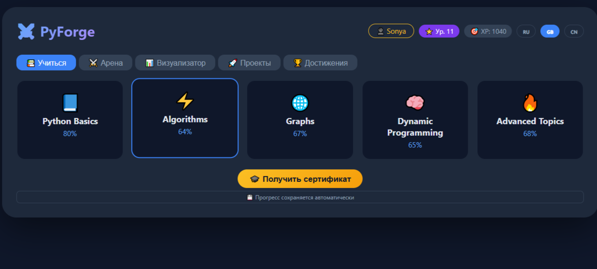
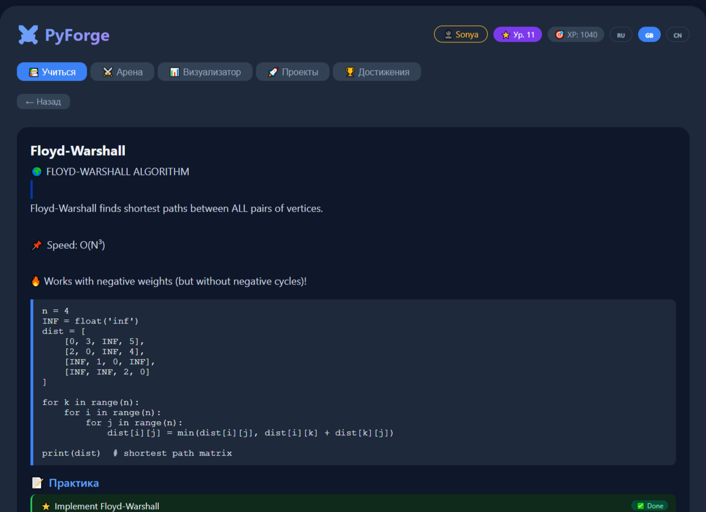
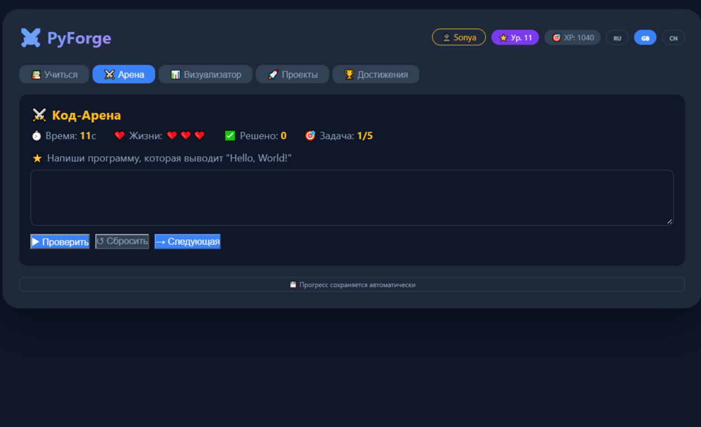
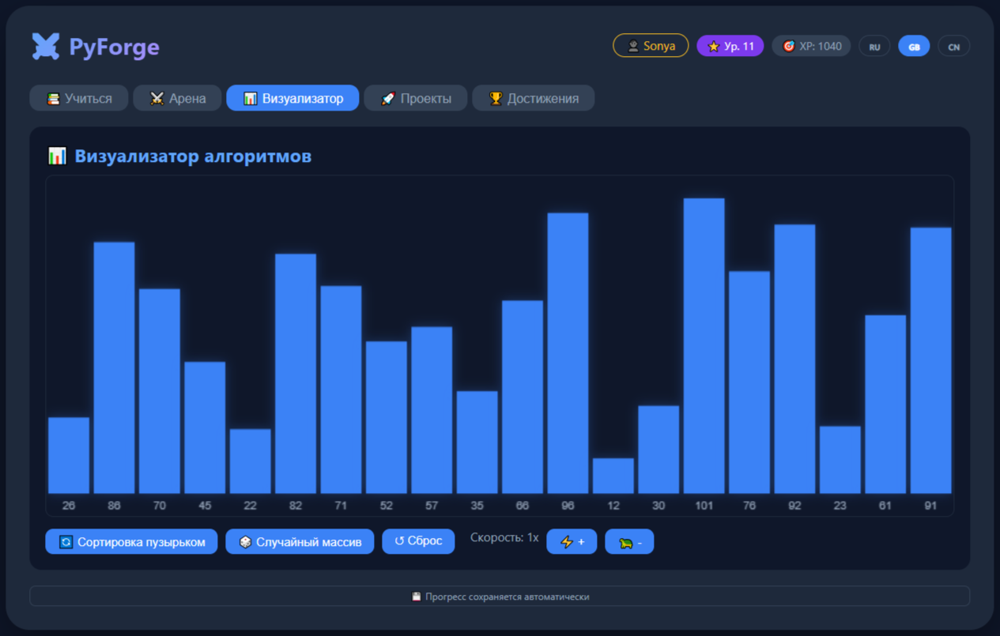

# PyForge — Interactive Python Learning Platform

PyForge is a web application I built to help my classmates learn Python in an interactive way. I started it in May 2025 (8th grade) and have been developing it gradually — from simple theory to a full platform with coding tasks, an arena, and a certificate generator.

🔗 **Live site:** https://mikylya.github.io/pyforge/

## What's inside

- **5 modules:** from Python basics to advanced algorithms (graphs, dynamic programming, segment trees)
- **Theory + practice:** 27 topics, each with an explanation, code example, and 5 coding tasks with automatic checking
- **XP and level system:** gamification to keep users motivated
- **Code Arena:** 5 timed tasks with lives and score
- **Sorting visualizer:** algorithm animation on Canvas
- **Project module:** 4 mini-projects (calculator, guess the number, password generator, palindrome checker)
- **Achievements:** 6 badges for progress
- **PDF certificate generation:** via html2canvas and jsPDF
- **Three interface languages:** Russian, English, Chinese

## Technologies

- **HTML, CSS, JavaScript** — everything in a single file, no frameworks
- **html2canvas + jsPDF** — for certificate generation
- **localStorage** — for saving progress
- **Canvas API** — for sorting visualization

## Development story

I started PyForge in May 2025, when I was in 8th grade. The idea was simple: build a tool that would help my classmates learn Python not through boring textbooks, but through interactive practice. The first version was just text with code examples. Then I added tasks with checking, the XP system, the arena, and the certificate. I wrote it in bursts — between school, olympiads, and other projects — but I tried to bring every part to a working state.

## Challenges (what broke and how I fixed it)

**Problem:** The Arena wouldn't start — I forgot to declare the `arenaTasks` array, even though I used it in three places (`renderArena`, the "Check" button handler, and the "Next" button).

**How I found it:** I opened the browser console (F12 → Console) and saw `arenaTasks is not defined`. I realized the variable was being used but never declared.

**How I fixed it:** I added `var arenaTasks = [...]` to the state block, next to `arenaCurrentTask`. When pasting, I accidentally duplicated `arenaCurrentTask` and `projectCompleted` — I removed the duplicates.

**What I learned:** Always check the browser console when something doesn't work. And don't paste code "by eye" — check for duplicates.

## Early versions

The `history/` folder contains early versions of PyForge from May–September 2025. They show the evolution from a simple lesson checker to a full platform:
- `v1_may_2025.html` — the first working prototype (lessons only, no AI).
- `v2_july_2025.html` — added AI tutor and achievements.
- `v3_september_2025.html` — added 28 lessons, 3 languages, and a premium system.
- 
## Roadmap

- Add new topics (file handling, error handling)
- Fix Arena progress saving (currently not synced with the main localStorage)
- Add another interface language
- Add screenshots to the portfolio

## Screenshots
### Main screen — 5 learning modules with progress

### Theory and practice — explanation, code example, and coding tasks

### Code Arena — timed tasks with lives and score

### Sorting visualizer — algorithm animation on Canvas

